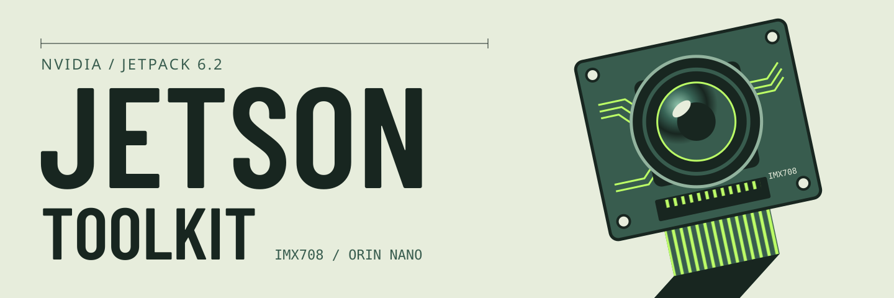

<p align="center">
  
</p>

# NVIDIA Jetson Toolkit

Getting the **Arducam IMX708 / Raspberry Pi Camera Module 3** working on a
**Jetson Orin Nano** running **JetPack 6.2** — with the exact, hardware-tested
device-tree and CSI parameters that actually work, and a clear list of the
things that *look* right but don't.


-76B900)


> **Why this repo exists:** the stock RidgeRun / `jetson-io` / `nvarguscamerasrc`
> path that works on JetPack 6.0 **fails on JetPack 6.2** (capture timeouts,
> missing ISP tuning, ignored overlays). This toolkit captures the specific
> configuration that gets a clean 4608×2592 @ 14fps capture on JP6.2, so you
> don't have to rediscover it — and it fixes the washed-out color most people
> hit, in software, since the IMX708 has no NVIDIA ISP tuning.

---

## Contents

- [The 60-second version](#the-60-second-version)
- [Supported configurations](#supported-configurations)
- [What works vs. what does NOT work on JetPack 6.2](#what-works-vs-what-does-not-work-on-jetpack-62)
- [Critical CSI parameters](#critical-csi-parameters-the-actual-fix)
- [Hardware prerequisites](#hardware-prerequisites)
- [Quick start](#quick-start)
- [Repository structure](#repository-structure)
- [Documentation](#documentation)
- [Capturing images](#capturing-images)
- [Image quality & color](#image-quality--color)
- [Troubleshooting & FAQ](#troubleshooting--faq)
- [Specifications](#specifications)
- [Licensing](#licensing)
- [Credits](#credits)
- [Contributing](#contributing)

---

## The 60-second version

On JetPack 6.2 the IMX708 works, but **only** with a hand-corrected device
tree and raw V4L2 capture:

1. Build the `nv_imx708` kernel module from
   [`jp62-imx708-rpi-v3/driver/`](jp62-imx708-rpi-v3/driver/).
2. Use the **corrected** overlay
   [`docs/overlays/imx708-nvidia-csi.dts`](docs/overlays/imx708-nvidia-csi.dts)
   — *not* the driver's bundled `dts/` overlay, which ships RidgeRun's original
   CSI values and times out on JP6.2 (see
   [Critical CSI parameters](#critical-csi-parameters-the-actual-fix)).
3. **Pre-merge** that overlay into the base DTB with `fdtoverlay` and point the
   `FDT` line in `extlinux.conf` at the result. The `OVERLAYS` directive is
   ignored by the UEFI boot flow on JP6.2.
4. Capture raw Bayer with `v4l2-ctl` and debayer in Python/OpenCV.
   `nvarguscamerasrc` needs ISP tuning files that don't exist for the IMX708.

Full walkthrough: **[docs/installation.md](docs/installation.md)**.

---

## Supported configurations

| Camera | Platform | JetPack | Status |
|--------|----------|---------|--------|
| Arducam IMX708 12MP (RPi Cam Module 3) | Orin Nano Super | 6.2 (L4T R36.4.3) | ✅ Working |
| Arducam IMX708 12MP | Orin Nano | 6.2 (L4T R36.4.3) | ✅ Working |
| Arducam IMX708 12MP | Orin Nano | 6.0, 5.1.1 | ↩ Use [RidgeRun's patches](https://github.com/RidgeRun/NVIDIA-Jetson-IMX708-RPIV3) |
| Arducam IMX708 12MP | Jetson Nano | 4.6.4 | ↩ Use [RidgeRun's patches](https://github.com/RidgeRun/NVIDIA-Jetson-IMX708-RPIV3) |

The genuine Raspberry Pi Camera Module 3 and the Arducam IMX708 module use the
same Sony IMX708 sensor and behave identically here.

### How this compares to other IMX708 drivers

Arducam now ships an official IMX708 driver for the Orin Nano, and RidgeRun's
driver exists too — both get the sensor probing, but users frequently report
**poor image quality / color** on JetPack 6.2, because the default ISP path has
no IMX708 tuning. This repo's value-add is the **corrected JP6.2 CSI parameters**
(so capture doesn't time out), **CAM1-aware validation/diagnostic tooling**, and
a **software color pipeline** that tackles the quality problem directly (see
[Image quality & color](#image-quality--color)) — plus the documented learnings
behind all of it. If your sensor is already detected via Arducam's driver, you
can still borrow this repo's raw capture + Python processing for better color.

---

## What works vs. what does NOT work on JetPack 6.2

### What works

| Component | Configuration |
|-----------|---------------|
| Driver | RidgeRun `nv_imx708.ko` with the `sony,imx708` compatible string |
| Device tree | The corrected NVIDIA-CSI overlay, **pre-merged** with `fdtoverlay` |
| Boot | `FDT` line in `extlinux.conf` pointing at the merged DTB |
| Capture | `v4l2-ctl --stream-mmap` for raw Bayer (RG10) |
| Processing | Python + OpenCV with percentile normalization + gray-world white balance |

### What does NOT work

| Approach | Why it fails on JP6.2 |
|----------|-----------------------|
| The driver's **bundled** `dts/…-cam1.dts` overlay | Ships RidgeRun's original CSI params (`channel@1`, `discontinuous_clk="yes"`, `lane_polarity="6"`) → `uncorr_err: request timed out` |
| `jetson-io` "Camera IMX477-C" mode | Capture timeouts, no frames |
| `nvarguscamerasrc` | Requires per-sensor ISP tuning files that don't exist for the IMX708 |
| GStreamer `v4l2src` negotiation | `not-negotiated` errors on the raw Bayer caps |
| `OVERLAYS` directive in `extlinux.conf` | UEFI boot ignores runtime overlays — you must pre-merge the DTB |
| Simple bit-shift (`>>2`) normalization | Washed-out / overexposed images; use percentile stretch |

---

## Critical CSI parameters (the actual fix)

The breakthrough was using **NVIDIA's** CSI parameters (from their IMX219/IMX477
overlays) with the IMX708 sensor timings, instead of RidgeRun's defaults:

| Parameter | RidgeRun default (FAILS) | NVIDIA value (WORKS) |
|-----------|--------------------------|----------------------|
| `discontinuous_clk` | `"yes"` | `"no"` |
| `lane_polarity` | `"6"` | `"0"` |
| NVCSI channel | `channel@1` | `channel@0` |

These corrected values are already applied in
[`docs/overlays/imx708-nvidia-csi.dts`](docs/overlays/imx708-nvidia-csi.dts).
The camera still connects to the **CAM1** physical port (I²C bus 9,
`cam_i2cmux/i2c@1`, sensor at `0x1a`) — only the NVCSI channel node uses
`channel@0`.

---

## Hardware prerequisites

| Component | Recommended | Notes |
|-----------|-------------|-------|
| Board | Jetson Orin Nano Super (8GB) | The board this repo was tested on |
| Camera | [Arducam 12MP IMX708 Wide-Angle](https://www.arducam.com/product/arducam-12mp-imx708-wide-angle-camera-module-for-raspberry-pi/) | The exact module this repo was tested with. Any IMX708 module (incl. a genuine RPi Camera Module 3) uses the same sensor. |
| Ribbon cable | 15-pin (camera) ↔ 22-pin (Jetson) CSI FFC | 15cm/30cm; contacts face the heatsink |
| Storage | NVMe SSD or 64GB+ microSD | NVMe recommended for capture throughput |
| OS | JetPack 6.2 (L4T R36.4.3) flashed and booted | [Download](https://developer.nvidia.com/embedded/jetpack) |

⚠️ **Power the Jetson off before connecting the camera.** Connect to **CAM1**,
not CAM0 — JetPack 6.2 only supports the IMX708 on CAM1. Ribbon contacts face
**toward the heatsink/fan**. See
[docs/installation.md](docs/installation.md#physical-setup) for photos and the
common-mistakes table.

---

## Quick start

Assumes JetPack 6.2 is flashed, the camera is on CAM1, and you have build tools
installed (`sudo apt install build-essential device-tree-compiler nvidia-l4t-kernel-headers nvidia-l4t-kernel-oot-headers`).

```bash
# 1. Build the kernel module
cd jp62-imx708-rpi-v3/driver
./build.sh                      # builds src/nv_imx708.ko
sudo ./build.sh install         # installs the module + autoload config

# 2. Build the CORRECTED overlay (not the bundled dts/ one)
cd ../..
dtc -@ -I dts -O dtb -o imx708-nvidia-csi.dtbo docs/overlays/imx708-nvidia-csi.dts

# 3. Pre-merge it into the base DTB (OVERLAYS directive is ignored on JP6.2)
sudo fdtoverlay \
    -i /boot/tegra234-p3768-0000+p3767-0005-nv.dtb \
    -o /boot/tegra234-p3768-0000+p3767-0005-imx708-nvidia-csi.dtb \
    imx708-nvidia-csi.dtbo

# 4. Point extlinux.conf at the merged DTB via an FDT line, then reboot.
#    (See docs/installation.md for the exact extlinux stanza.)
sudo reboot

# 5. Verify
ls /dev/video0
v4l2-ctl -d /dev/video0 --info
dmesg | grep imx708
jp62-imx708-rpi-v3/driver/scripts/validate.sh
```

> Prefer scripts? [`scripts/apply_overlay.sh`](jp62-imx708-rpi-v3/driver/scripts/apply_overlay.sh)
> and [`scripts/fix_extlinux.sh`](jp62-imx708-rpi-v3/driver/scripts/fix_extlinux.sh)
> automate the pre-merge + `FDT` wiring.

---

## Repository structure

```
nvidia-jetson-toolkit/
├── README.md                           # This file
├── CLAUDE.md                           # AI-agent context / notes
├── LICENSE                             # MIT (project-authored files)
├── docs/
│   ├── installation.md                 # Full IMX708 installation guide
│   ├── ssh-setup.md                    # Headless SSH access to the Jetson
│   └── overlays/
│       └── imx708-nvidia-csi.dts       # ✅ The working (corrected) overlay
└── jp62-imx708-rpi-v3/
    └── driver/                         # RidgeRun-derived kernel driver (GPL-2.0)
        ├── COPYING                     # GPL-2.0 license text for this subtree
        ├── src/                        # Kernel module source (nv_imx708.c, mode tables)
        ├── include/                    # Driver headers
        ├── dts/                        # Bundled overlays (RidgeRun defaults — see note)
        ├── scripts/                    # validate / diagnose / apply-overlay / fix-extlinux
        ├── build.sh                    # Native build helper
        ├── Makefile                    # Module + overlay build
        └── README.md                   # Driver-specific build/usage notes
```

> **Note on `driver/dts/`:** those overlays contain RidgeRun's original CSI
> parameters and are kept for reference / other JetPack versions. For JP6.2 use
> `docs/overlays/imx708-nvidia-csi.dts` instead.

---

## Documentation

| Document | Description |
|----------|-------------|
| [Installation guide](docs/installation.md) | Complete, hardware-tested setup with troubleshooting |
| [SSH setup](docs/ssh-setup.md) | Configure headless SSH access to the Jetson |
| [Driver README](jp62-imx708-rpi-v3/driver/README.md) | Driver build/usage and the JP6.2 compatibility notes |

---

## Capturing images

`nvarguscamerasrc` is unavailable (no ISP tuning), so capture raw Bayer with
`v4l2-ctl` and process it in Python:

```bash
v4l2-ctl -d /dev/video0 \
    --set-fmt-video=width=4608,height=2592,pixelformat=RG10 \
    --stream-mmap --stream-count=1 \
    --stream-to=/tmp/frame.raw
```

```python
import numpy as np
import cv2

# RG10 = 10-bit Bayer in a 16-bit container
raw = np.fromfile("/tmp/frame.raw", dtype=np.uint16)
img = raw[:4608 * 2592].reshape((2592, 4608))

# Percentile stretch handles varying lighting far better than a bit-shift
p2, p98 = np.percentile(img, [2, 98])
img_norm = np.clip((img.astype(float) - p2) / (p98 - p2) * 255, 0, 255).astype(np.uint8)

color = cv2.cvtColor(img_norm, cv2.COLOR_BAYER_RG2BGR)
cv2.imwrite("/tmp/capture.jpg", color)
```

The [installation guide](docs/installation.md#image-capture-and-processing) has
gray-world white balance, continuous capture, and an `IMX708Camera` OpenCV
wrapper class.

---

## Image quality & color

Two things nearly everyone hits with the IMX708 on Jetson: washed-out or
off-color images, and the question *"where's the `camera_overrides.isp` tuning
file?"*

**This repo does not use the NVIDIA ISP, so there is no `camera_overrides.isp`
— by design.** `nvarguscamerasrc` and the hardware ISP need per-sensor tuning
files that NVIDIA doesn't ship for the IMX708. Rather than fight that, this
toolkit captures raw Bayer over V4L2 and corrects the image **in software**:

- **Percentile normalization** (2nd–98th percentile stretch) for exposure —
  far better than a naive `>>2` bit-shift, which looks washed out.
- **Gray-world white balance** to remove the color cast.

That software pipeline *is* the color-tuning result — it lives in the Python in
[docs/installation.md](docs/installation.md#image-capture-and-processing), not
in an `.isp` file.

**If you specifically want the ISP / `nvarguscamerasrc` path** (hardware color,
auto-exposure/AWB), you need an IMX708 ISP tuning file, which neither NVIDIA nor
this repo provides. The community starting point is to reuse an **IMX477**
`camera_overrides.isp` (under `/var/nvidia/nvcam/settings/`) and hand-tune it —
expect approximate color, since it isn't matched to the IMX708. That's the route
some people take on top of Arducam's official driver.

> **Maintainer TODO:** multiple users have asked for a tuned IMX708
> `camera_overrides.isp`. This repo intentionally ships the software pipeline
> above rather than an ISP tuning file. If a hand-tuned `.isp` exists on the
> capture Jetson, add it here (e.g. under an `isp/` directory) with install
> notes; until then, the software path is the supported answer.

---

## Troubleshooting & FAQ

**`uncorr_err: request timed out` / capture hangs.**
You're almost certainly on RidgeRun's original CSI params. Confirm your overlay
uses `discontinuous_clk="no"`, `lane_polarity="0"`, and `channel@0` — i.e. the
`docs/overlays/imx708-nvidia-csi.dts` overlay, pre-merged into the DTB. Then
re-check the ribbon cable seating and orientation.

**No `/dev/video0` after reboot.**
Run [`scripts/validate.sh`](jp62-imx708-rpi-v3/driver/scripts/validate.sh) or
[`scripts/diagnose_full.sh`](jp62-imx708-rpi-v3/driver/scripts/diagnose_full.sh).
Check, in order: module loaded (`lsmod | grep imx708`), camera on **CAM1**
(`sudo i2cdetect -y -r 9` should show `1a`, or `UU` once the driver is bound),
and that the merged DTB is
referenced by the `FDT` line in `extlinux.conf`.

**I added `OVERLAYS …` to `extlinux.conf` and nothing changed.**
Expected — the UEFI boot flow on JP6.2 ignores the `OVERLAYS` directive. You
must pre-merge the overlay into the base DTB with `fdtoverlay` and point the
`FDT` line at the merged file. See [Quick start](#quick-start).

**`nvarguscamerasrc` errors out or gives black frames.**
Also expected. `nvarguscamerasrc` requires NVIDIA ISP tuning files that don't
exist for the IMX708. Use the raw V4L2 + Python path above.

**Camera not detected on I²C.**
Verify it's on **CAM1** (not CAM0), the ribbon contacts face the heatsink, and
the cable is fully seated with the latch closed. Power-cycle (full shutdown, not
just reboot). On CAM1 the sensor appears at `0x1a` on **bus 9** (via the
`cam_i2cmux`), not bus 2.

**The kernel module loads but the camera still isn't detected.**
"Module loaded" (`lsmod | grep nv_imx708`) only means the driver is resident —
it does not mean the sensor was found. If `sudo i2cdetect -y -r 9` shows nothing
at `0x1a` and there's no `/dev/video0`, the sensor never ACKed. Work through, in
order: (1) camera on **CAM1**, not CAM0; (2) ribbon contacts toward the
heatsink, fully seated, latch closed; (3) full power-cycle, not just reboot;
(4) confirm the merged imx708 DTB is actually booted (the `FDT` line) and run
`dmesg | grep -i imx708`. A probe attempt that then times out points at CSI
params/cabling; **no** probe line at all means the device tree isn't being
applied.

**What exact camera did this repo use?**
An **Arducam 12MP IMX708 Wide-Angle** module
([product page](https://www.arducam.com/product/arducam-12mp-imx708-wide-angle-camera-module-for-raspberry-pi/)),
on CAM1 with a 15-pin ↔ 22-pin CSI ribbon. Any IMX708-based module (including
the genuine Raspberry Pi Camera Module 3) uses the same sensor and should behave
identically.

**Is the poor color — or 14fps — the camera's ceiling?**
No. The poor *color* is just the ISP-less raw output; the software pipeline in
[Image quality & color](#image-quality--color) recovers it well. The single
4608×2592 @ 14fps mode is a limit of this driver's mode table, not the sensor —
there are simply no binned modes exposed here.

**Module fails to load / `vermagic` mismatch.**
Rebuild against your running kernel: `uname -r` must match
`modinfo src/nv_imx708.ko | grep vermagic`. Reinstall
`nvidia-l4t-kernel-headers` / `nvidia-l4t-kernel-oot-headers` for the current
L4T and rebuild.

**Images are washed out, too dark, or have a color cast.**
This is the #1 IMX708-on-Jetson complaint and it's expected from the raw sensor
output. Correct it in software — percentile normalization (not `>>2`) plus
gray-world white balance — and tune exposure/gain:
`v4l2-ctl -d /dev/video0 -c exposure=20000 -c gain=64`. See
[Image quality & color](#image-quality--color) for why there is no
`camera_overrides.isp` file.

**Can I use a different resolution or higher frame rate?**
This driver exposes a single mode: 4608×2592 at up to 14fps. No binned modes.

**Does autofocus work?**
This raw-V4L2 capture path does not expose the IMX708 voice-coil focuser, so
focus is whatever the module powers on to. Focuser control would require
additional driver work.

**Which JetPack does this target?**
JetPack 6.2 (L4T R36.4.3) specifically. For 6.0 / 5.1.1 / Jetson Nano 4.6.4,
use [RidgeRun's original patches](https://github.com/RidgeRun/NVIDIA-Jetson-IMX708-RPIV3).

---

## Specifications

| Parameter | Value |
|-----------|-------|
| Sensor | Sony IMX708 |
| Resolution | 4608 × 2592 (12MP) |
| Frame rate | 14fps (max at full resolution) |
| Pixel format | RG10 (10-bit Bayer, RGGB) |
| Interface | CSI-2, 2 lanes |
| I²C address | `0x1a` |
| I²C bus | Bus 9 (CAM1, via `cam_i2cmux`) |

---

## Licensing

This is a mixed-license repository:

- **Project-authored material** (documentation, examples, and scripts outside
  `jp62-imx708-rpi-v3/driver/`) is available under the [MIT License](LICENSE).
- **The bundled kernel driver** in
  [`jp62-imx708-rpi-v3/driver/`](jp62-imx708-rpi-v3/driver/) is derived from
  RidgeRun's `nv_imx708` driver and the Linux kernel and is licensed under
  **GPL-2.0**, per the license headers in each source file. The full GPL-2.0
  text is in [`jp62-imx708-rpi-v3/driver/COPYING`](jp62-imx708-rpi-v3/driver/COPYING).
- **NVIDIA, RidgeRun, and Raspberry Pi** copyrights and notices remain with
  their respective owners; see the individual source-file headers for the
  controlling terms where they differ.

---

## Credits

- **[RidgeRun](https://ridgerun.com/)** — original `nv_imx708` driver and
  excellent Jetson camera support ([driver source](https://github.com/RidgeRun/NVIDIA-Jetson-IMX708-RPIV3)).
- **[NVIDIA](https://developer.nvidia.com/)** — the Jetson platform and the CSI
  overlay structure this build borrows from.
- **[Arducam](https://www.arducam.com/)** — the IMX708 camera module.
- The **Jetson community** on the
  [NVIDIA Developer Forums](https://forums.developer.nvidia.com/) for shared
  debugging knowledge.

## Contributing

Found a fix, a missing step, or a config that works on hardware this repo
hasn't covered?

1. **Open an issue** describing your board, JetPack version, and symptoms.
2. **Submit a pull request** — hardware-verified corrections are especially welcome.
3. **Share your results** on the
   [NVIDIA Developer Forums](https://forums.developer.nvidia.com/).

---

**Tested on:** Jetson Orin Nano Super 8GB · JetPack 6.2 (L4T R36.4.3) · Arducam IMX708
